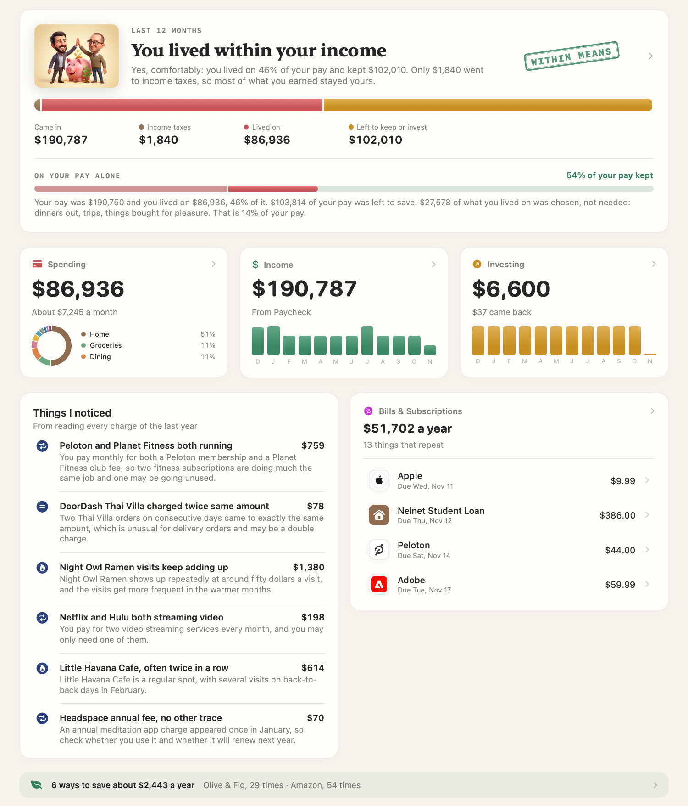
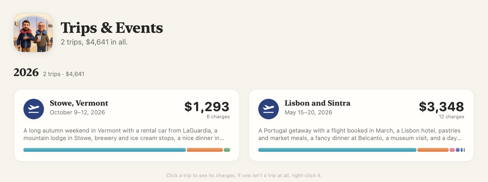
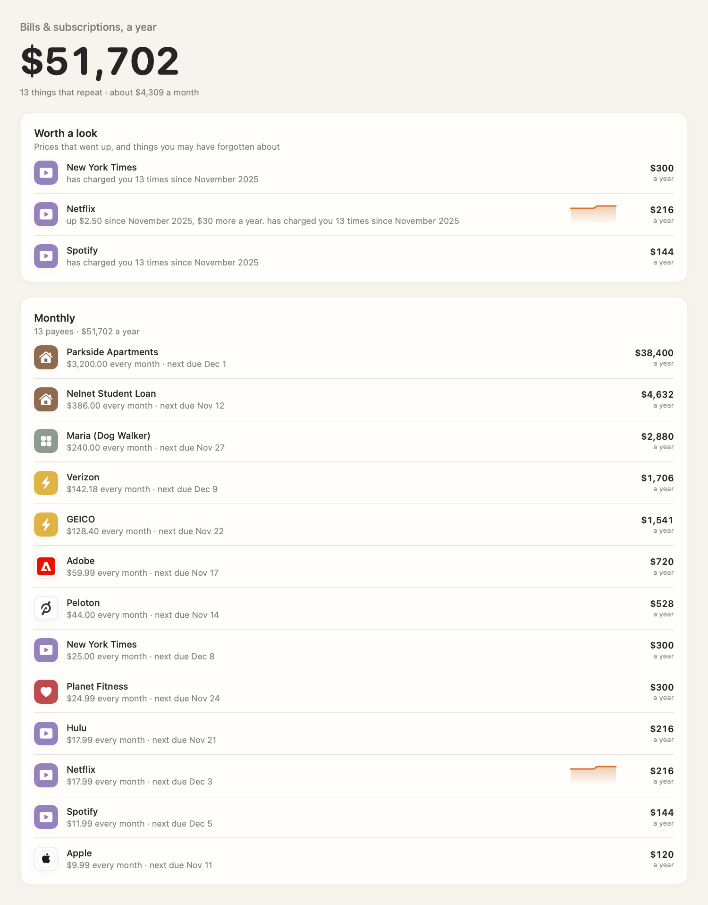
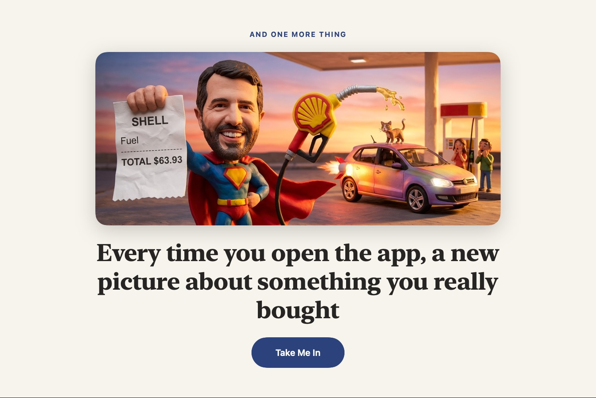

# Spendthrift

<p align="center"></p>

A Mac app that reads your bank and card statements and shows where the money went, whether you
lived within your means, and what is worth a second look. No account linking: you drop in the
files your bank already gives you.

It was designed around three things.

- **Magic.** Drop in a folder of statements in any format and about a minute later every payee has a
  name and a category, trips are found and costed, bills and subscriptions are listed with what they
  cost a year, and the app tells you what it noticed. You can ask questions in plain English.
- **Whimsy.** Each day opens on a new cartoon about something you really bought, with one of the
  cast holding the receipt (the real payee, the real total). An import plays as a short show and
  ends in a premiere of what it found.
- **Tying everything out.** Every figure on screen is added up in code, never by a model. Each PDF is
  checked against the totals printed on it, to the cent. Card payments leaving the bank are tied to
  the card's own statements so nothing is counted twice. Text from a model that contains a dollar
  amount the app did not supply is thrown away.

And one constraint: **as little as possible leaves your Mac.**

<p align="center"></p>

<p align="center">
  <br>
  
</p>

<p align="center"></p>

The pictures above are the app running on the made-up household in `docs/demo`.

## Getting started

Requires an Apple Silicon Mac on macOS 26, the Command Line Tools (or Xcode), and an
[OpenRouter](https://openrouter.ai/keys) key. There is no download: you build it.

```sh
git clone https://github.com/pwolpe/spendthrift.git && cd spendthrift
scripts/build.sh
open build/Spendthrift.app
```

1. Paste your OpenRouter key on the welcome screen. Give the key a spending limit at OpenRouter; a
   statement costs a few cents to read and sort.
2. Drop in your statements, or try the two files in `docs/demo` first. CSV, Excel, PDF (scans and
   password-protected ones too), photos, Quicken files, zips and whole folders all work.
3. To update, `git pull` and build again. Your data lives outside the app and is untouched.

## What leaves your Mac

Statements are read, stored and added up on your Mac. The app runs on AI models reached through
your own OpenRouter key, and each is sent only what its job needs:

| For | What is sent |
| --- | --- |
| Sorting a payee | The bank's text for it, its typical amount and how often it appears, with reference numbers, phone numbers and emails removed |
| A statement the app cannot read alone | Its text, with your name, address, email and account numbers blanked. The reading is kept only if it adds up to the statement's printed totals |
| A paid check | The picture of that one page; only number, amount, payee and memo are asked for back |
| Trips and things noticed | Your charges: payee, date, amount |
| Questions and short notes | The question, and the figures the app already worked out |
| The day's picture | One purchase (payee and total) and the cast's photos that ship with the app |

Never sent: your name, address, account numbers, or the saved data file. The key is kept in a
private file only your account can read. Beyond the models, the app fetches only pictures: a
business's logo by its web address, and an Amazon product photo by its product number. There are no
accounts, no analytics and no update checks. **Settings** has switches for reading statements and for web lookups of
unfamiliar payees, and **Accounts** shows what every request cost.

If OpenRouter cannot be reached, an import still finishes on the built-in rules, a banner says so,
and the rest is picked up on the next try.

## What it shows

- **The verdict**: what came in, what you lived on, taxes, and what was left, then again on your pay
  alone.
- **What changed and why**, in dollars that add up to the difference.
- **Bills & Subscriptions**: what repeats, what it costs a year, what crept up, what may be forgotten.
- **Trips & Events**, **Things noticed**, **Ways to save**, **Where to trim** (needs apart from wants),
  and budgets that set themselves from your last six months.
- **Payees that tidy themselves**: duplicates combined when the app is sure, each with an Undo.
- **Amazon**: an order history matched to card charges, so "Amazon" becomes what was bought
  (`docs/amazon-refresh.md`).
- **Statements**: every statement kept as it came, opened at the line a charge was read from.
- **Ask**: questions in plain English, and instructions ("file Trader Joe's under Groceries") that
  happen only after you confirm.

Everything shown leads somewhere: a figure opens the charges behind it, and **Back** returns.

## For developers

No dependencies: Swift and Apple's frameworks (SwiftUI, Swift Charts, PDFKit, Vision). The idea
started from [davidfowl/tally](https://github.com/davidfowl/tally). `CONTRIBUTING.md` has the rules
the code keeps.

```sh
scripts/build.sh    # build/Spendthrift.app
scripts/test.sh     # builds, then the app checks itself, offline
```

**Data** lives in `~/Library/Application Support/Spendthrift/` (`library.json`, `orders.json`, daily
`Backups/`, `Statements/` as added, `Pictures/`). To move to another Mac, copy the folder.

**Code map**

| Where | What it does |
| --- | --- |
| `BudgetStore.swift`, `Store/` | The single source of truth, and its work, one file per concern |
| `Cloud/` | Everything sent to a model, one file per job. `ModelNames.swift` names every model, once; `Redactor.swift` blanks personal details; `CloudSpend.swift` keeps the cost ledger |
| `Importing.swift`, `CSV.swift`, `PDFStatement.swift`, `Scans.swift` | Reading statements |
| `Library.swift`, `Suggestions.swift` | The saved file, known businesses, and which payee a line is |
| `Changes.swift`, `Recurring.swift`, `Budgets.swift`, `Savings.swift`, `Tidy.swift`, `Insights.swift` | Engines: transactions in, findings out |
| `Ask.swift`, `AskChat.swift` | Questions answered from figures the app computes |
| `Views/` | The screens; `Components.swift` holds the shared pieces |
| `SelfTest.swift` | The checks: rules, sums that must agree, and doing what a person would do |
| `ModelBench.swift` | Which models to use, measured (`scripts/bench-models.sh`) |

**Models.** Which model does which job is decided in `Cloud/ModelNames.swift`, not by the person
using the app: a small decision model that only judges, a writing model, a second statement reader
from a different maker, and an image model. When a new model comes out, one run says whether to
change:

```sh
scripts/bench-models.sh                      # each model against the newest that could replace it
scripts/bench-models.sh maker/model          # also try this one
```

It puts every model through the jobs it does in the app (sorting payees, reading statements, finding
trips, answering questions; filing, grouping and judging payees for the decision model) on cases
whose answers are known without asking a model: categories you chose or the built-in list knows,
statements that tie to their own printed totals, trips planted in the made-up households of
`Tests/Bench`, figures added up in code. It works on a copy of your library and pays with your key
(a few dollars; `--budget` caps it). The report ends with the lines to put in `ModelNames.swift`, or
"nothing". A model that is worse at any job is out; a better one wins; one that is only as good has
to be clearly cheaper or faster. `Sources/Spendthrift/ModelBench.swift` holds the rules.

**Signing.** `build.sh` signs with a certificate named `Spendthrift Signing` if your keychain has one
(Keychain Access → Certificate Assistant → Create a Certificate, type Code Signing), so macOS keeps
permissions such as Downloads access from one build to the next. Without it the app still runs.

**Useful switches.** `SPENDTHRIFT_HOME=<dir>` runs against a scratch data folder,
`SPENDTHRIFT_IMPORT=a.csv:b.pdf` imports files first, `SPENDTHRIFT_SNAPSHOT=<dir>` saves a picture of
each screen and quits, `SPENDTHRIFT_NO_CLOUD=1` keeps it offline, and
`SPENDTHRIFT_FAIL_CLOUD=credit|key|offline` simulates a failure. `scripts/demo-data.py` rewrites the
demo statements. `build/Spendthrift.app/Contents/MacOS/Spendthrift --inspect file.pdf` previews how a
statement will be read.

The two cartoon friends in the pictures are Tony and Paul, who made the app. Their photos in
`Resources/` are the only personal thing in the repository.

MIT licensed: see `LICENSE`.
